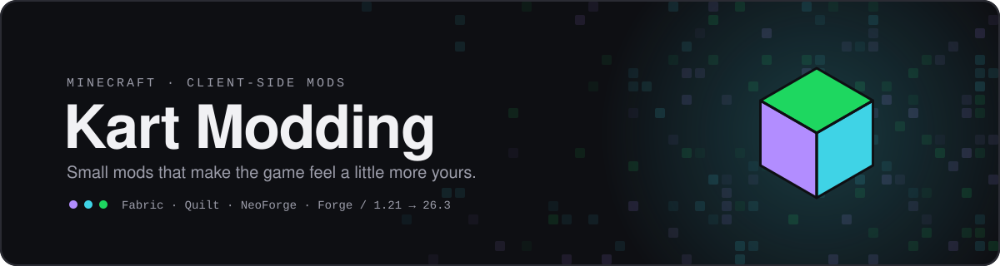
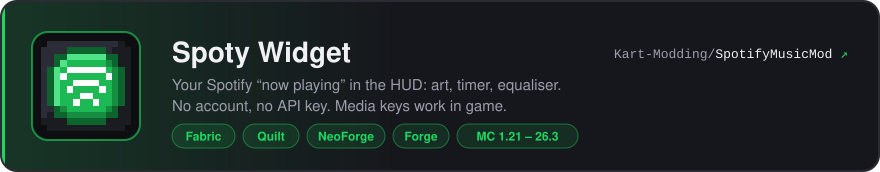
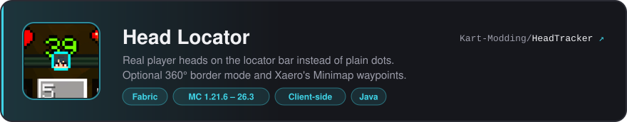
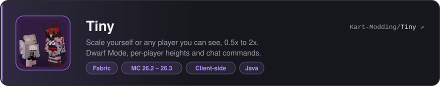

Hi, I'm Kartonek. I make small Minecraft mods. They're all client-side, so they work on any server.

## Mods

## Contributing

Bug reports and pull requests are welcome. Open an issue on the mod's repository and include your Minecraft version, loader and mod version. All mods are under the MIT License.

Made by <a href="https://modrinth.com/user/Kartonek">Kartonek</a> · Not affiliated with Mojang or Microsoft

